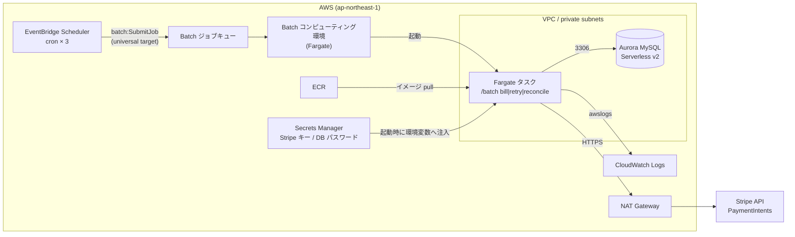
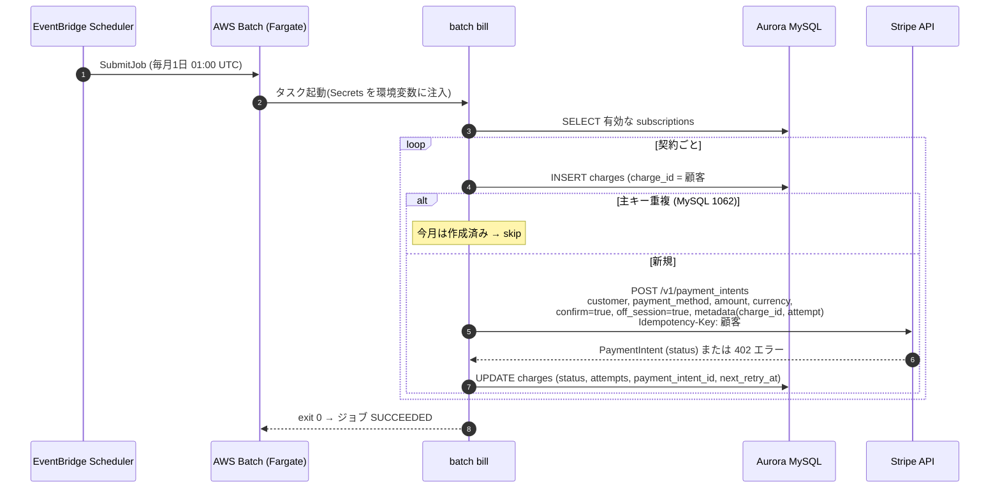
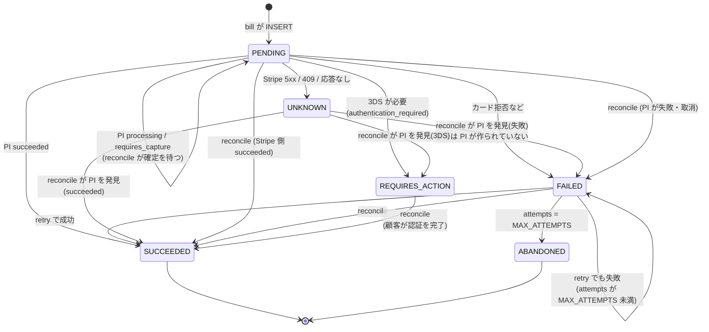

# credit-billing-batch

Stripe クレジットカード課金バッチ。**AWS Batch (Fargate)** 上で動き、データは **Aurora MySQL** に保存する。ローカルでは **Floci**(AWSエミュレータ。Aurora MySQL も本物の MySQL 8.0 コンテナで動く)と **stripe-mock** で検証できる。

## アーキテクチャ



- **起動**: [EventBridge Scheduler](https://docs.aws.amazon.com/scheduler/latest/UserGuide/schedule-types.html) が cron 式で起動し、[universal target](https://docs.aws.amazon.com/scheduler/latest/UserGuide/managing-targets-universal.html)(`arn:aws:scheduler:::aws-sdk:batch:submitJob`)で Batch の `SubmitJob` API を直接呼ぶ。Lambda などの中継は置かない。
- **実行**: [AWS Batch on Fargate](https://docs.aws.amazon.com/batch/latest/userguide/fargate.html) がジョブごとに 1 タスク(0.5 vCPU / 1 GB)を起動する。サーバーの管理は不要で、ジョブがないときの計算コストはかからない。ジョブの状態遷移は [Job states](https://docs.aws.amazon.com/batch/latest/userguide/job_states.html)(`SUBMITTED → RUNNABLE → STARTING → RUNNING → SUCCEEDED/FAILED`)のとおり。
- **シークレット**: Stripe キーと DB パスワードはジョブ定義の `secrets` で参照し、[タスク起動時に実行ロールが取得して環境変数として注入](https://docs.aws.amazon.com/batch/latest/userguide/specifying-sensitive-data-secrets.html)する。DB パスワードは [RDS が管理するシークレット](https://docs.aws.amazon.com/AmazonRDS/latest/AuroraUserGuide/rds-secrets-manager.html)の JSON キーを `<secret-arn>:password::` で指定する。値が読まれるのはジョブ起動時だけなので、ローテーション後も次のジョブから新しい値が使われる。
- **ロール**: [実行ロール](https://docs.aws.amazon.com/batch/latest/userguide/execution-IAM-role.html)(イメージ pull・ログ出力・シークレット取得)とジョブロール(アプリ自身の権限。現状は AWS API を呼ばないので空)を分けている。
- **ネットワーク**: タスクは private subnet で動き、Stripe へは NAT 経由で出る。[NAT がない private subnet では `assignPublicIp` を `ENABLED` にする必要がある](https://docs.aws.amazon.com/batch/latest/userguide/fargate-job-definitions.html)。Aurora はタスクの SG からの 3306 だけを受け付ける。
- **DB**: [Aurora Serverless v2](https://docs.aws.amazon.com/AmazonRDS/latest/AuroraUserGuide/aurora-serverless-v2.html)。バッチは 1 日に数分しか動かないため、`db_min_acu = 0` にすると[自動停止(auto-pause)](https://docs.aws.amazon.com/AmazonRDS/latest/AuroraUserGuide/aurora-serverless-v2-auto-pause.html)でアイドル時のインスタンス料金をゼロにできる(Aurora MySQL 3.08.0 以上。再開には通常約 15 秒、24 時間以上停止していると 30 秒以上かかる)。
- **ログ**: アプリは JSON(`log/slog`)を標準出力に書き、[awslogs ドライバー](https://docs.aws.amazon.com/batch/latest/userguide/using_awslogs.html)で `/aws/batch/credit-billing` に送る。

## ジョブ
| コマンド | 内容 | 既定スケジュール(UTC) |
|---|---|---|
| `batch bill [--period YYYY-MM]` | 有効な契約ごとに charge を作成し、Stripe で 1 回目の請求をする。再実行しても二重課金しない | 毎月1日 01:00(JST 10:00) |
| `batch retry` | `FAILED` と、再試行時刻を過ぎた `PENDING` を再請求する。`MAX_ATTEMPTS`(4)回で `ABANDONED` | 毎日 02:00 |
| `batch reconcile` | Stripe の PaymentIntent の状態と DB を突き合わせ、Stripe 側で `succeeded` なのに DB が未反映のものを直す | 毎日 03:00 |
| `batch migrate` | テーブル作成(冪等)。デプロイ後に手動で SubmitJob する | なし |

Batch のジョブ定義は `retry_strategy { attempts = 1 }` にしている。[Batch の自動リトライ](https://docs.aws.amazon.com/batch/latest/userguide/job_retries.html)はジョブ全体を再実行してしまうため、課金のやり直しはアプリ側(`retry` ジョブ)で 1 件ずつ制御する。

## 処理フロー

### 月次課金(`bill`)



### charge の状態遷移



| Stripe の結果 | charge の status | 次の処理 |
|---|---|---|
| `succeeded` | `SUCCEEDED` | 完了 |
| 402 + `authentication_required`、または PI が `requires_action`(3DS などの認証が必要) | `REQUIRES_ACTION` | バッチでは再請求しない(顧客の認証なしでは成功しないため)。顧客が認証を終えたら `reconcile` が拾う |
| `processing` / `requires_capture` | `PENDING` | `retry` の対象外。`reconcile` が Stripe の確定を確認し、成功なら `SUCCEEDED`、失敗・取消なら `FAILED` |
| 5xx / 409 / 応答なし(結果不明) | `UNKNOWN` | `retry` の対象外。1 時間以上経ってから `reconcile` が PaymentIntent を探して結果を確定する |
| 上記以外のエラー(カード拒否など) | `FAILED` | `attempts × RETRY_BACKOFF` 後に `retry`。`MAX_ATTEMPTS` に達したら `ABANDONED` |

### 再請求(`retry`)
- `next_retry_at` を過ぎた `FAILED` に、`attempts + 1` 回目の請求をする(新しい Idempotency-Key)。
- PaymentIntent を持たない `PENDING` は、`bill` が Stripe 呼び出し後に落ちて結果を保存できなかったもの。保存されていない試行をやり直すので、同じ回数・同じキー(`attempt-1` など)で再送し、二重課金にならない。
- PaymentIntent を持つ `PENDING`(Stripe で処理中)と `UNKNOWN` は対象にしない。新しい PaymentIntent を作ると、元の請求が成功したときに二重課金になるため。

### 突合(`reconcile`)
- PaymentIntent ID を持つ `PENDING` / `FAILED` / `REQUIRES_ACTION` について [`GET /v1/payment_intents/:id`](https://docs.stripe.com/api/payment_intents/retrieve) を呼ぶ。Stripe 側が `succeeded` なら `SUCCEEDED` にする。`PENDING` で Stripe 側が `requires_payment_method` / `canceled` になっていれば `FAILED` にして再請求を予約する。
- `UNKNOWN` は、試行から 1 時間以上経ったものについて、顧客の PaymentIntent を [`GET /v1/payment_intents?customer=…&created[gte]=…`](https://docs.stripe.com/api/payment_intents/list) で一覧し、metadata(`charge_id`、`attempt`)が一致するものを探す。
  - 見つかれば、その状態(と `last_payment_error` のコード)で上の表と同じように確定する。
  - 見つからなければ Stripe は PaymentIntent を作っていないので、`FAILED` にして次の試行を予約する。次の試行は新しいキーでも二重課金にならない。
  - 1 時間待つのは、Stripe が障害からの復旧中に失敗したリクエストを後から処理することがあるため([Advanced error handling](https://docs.stripe.com/error-low-level))。

## Stripe 連携
保存済みのカードに、顧客がその場にいない状態で請求する [off-session 決済](https://docs.stripe.com/payments/save-and-reuse?payment-ui=elements)をしている。
- 前提: 顧客(`Customer`)と再利用可能な `PaymentMethod`(SetupIntent などで off-session 利用の同意を取って保存したもの)は、このバッチの外で作られて `subscriptions` に登録されている。
- 請求: [`POST /v1/payment_intents`](https://docs.stripe.com/api/payment_intents/create) に `off_session=true`(顧客がいないので認証要求に応えられないことを示す)と `confirm=true`(作成と同時に確定)を付けて 1 回の API 呼び出しで済ませる。metadata に `charge_id` と `attempt` を入れ、結果が分からなかった試行を後から探せるようにしている。
- 失敗時: Stripe は [HTTP 402 を返し、PaymentIntent の status は `requires_payment_method` に戻る](https://docs.stripe.com/payments/save-and-reuse?payment-ui=elements)。3DS が必要な場合も同じで、`requires_action` ではなく decline code `authentication_required` で区別する。エラーには PaymentIntent が含まれるので、その ID を保存して `reconcile` で追えるようにしている。拒否理由は [decline code](https://docs.stripe.com/declines) で分かる。
- 結果不明: [5xx は結果不明として扱い、結果を確かめるまで新しいキーで再試行しない](https://docs.stripe.com/error-low-level)。409(同じキーのリクエストが実行中)と、SDK の再試行後も応答がない場合も同じ扱いにしている。
- PaymentIntent の状態は [ライフサイクル](https://docs.stripe.com/payments/paymentintents/lifecycle)のとおり(`requires_payment_method` → `requires_confirmation` → `requires_action` → `processing` → `succeeded`、または `canceled`)。
- ネットワーク断: stripe-go の `MaxNetworkRetries = 2` で[自動再試行](https://docs.stripe.com/error-low-level)する。再試行には同じ Idempotency-Key が使われる。

## 二重課金を防ぐ仕組み
| 層 | 仕組み | 防げるもの |
|---|---|---|
| DB | `charges.charge_id = 顧客#期間` の主キー。重複 INSERT(エラー 1062)は「作成済み」として skip | `bill` の再実行・同じ月の二重起動 |
| Stripe | [Idempotency-Key](https://docs.stripe.com/api/idempotent_requests) `顧客#期間#attempt-N`。Stripe は最初のリクエストの結果(エラーを含む)を保存し、同じキーの再送には同じ結果を返す | Stripe 呼び出し後〜DB 更新前のクラッシュ、ネットワーク断での再送 |
| アプリ | 結果不明の試行は `UNKNOWN` にし、PaymentIntent の有無を確かめるまで新しいキーで再請求しない。処理中(PaymentIntent を持つ `PENDING`)も再請求しない | Stripe 5xx・応答なしの後の再請求 |
| Batch | ジョブ定義の `retry_strategy { attempts = 1 }` | Batch によるジョブ全体の自動再実行 |

Stripe は[キーを少なくとも 24 時間保持し、その後は削除することがある](https://docs.stripe.com/api/idempotent_requests)。同じ試行の再送が 24 時間以内に収まるよう、`retry` は毎日実行している。同じキーで異なるパラメーターを送るとエラーになる。

## 構成
- `cmd/batch`, `internal/{jobs,payment,store}` — Go 1.24 / stripe-go v82 / go-sql-driver/mysql
- `terraform/` — ECR, Aurora MySQL(Serverless v2、パスワードは RDS 管理の Secrets Manager シークレット), Secrets Manager(Stripeキー), Batch(Fargate計算環境・キュー・ジョブ定義x4), EventBridge Scheduler, IAM, CloudWatch Logs
- `docker-compose.yml` — `floci/floci` (4566、RDS プロキシ 7001-7099) と `stripe/stripe-mock` (12111)

## ローカル実行
```sh
make up            # Floci + stripe-mock 起動
make db            # Floci に Aurora MySQL クラスタ + writer を作成(127.0.0.1:7001)
make test          # DB_* が設定されていれば store の結合テストも MySQL に対して走る
make seed          # テーブル作成 + サンプル契約
make bill          # 課金実行
make retry reconcile
```

## Terraform
```sh
make tf-plan                 # Floci(localhost:4566)に対する plan
make tf-apply                # Floci に apply(自動承認)
make tf-plan  TF_ENV=aws     # 実 AWS。変数は terraform/aws.tfvars から読む
make tf-apply TF_ENV=aws     # 実 AWS に apply(確認プロンプトあり)
```
`TF_ENV` ごとに同名の Terraform workspace を使うので、Floci と AWS の state は混ざらない。Terraform のバージョンは `.tool-versions`(asdf)で 1.11.2 に固定している。
Floci は Batch ジョブ定義の `secrets` / `fargatePlatformConfiguration`、Scheduler、RDS のバックアップ保持期間を保持しないため、apply 後も `tf-plan` に差分が残る(実 AWS では出ない)。
ECR に push するイメージは `docker build -t localhost:4566/... .` 等で用意する(Floci の ECR は `registry:2`)。

## stripe-mock の注意
stripe-mock は**ステートレス**で、レスポンスは固定値(PaymentIntent は `requires_payment_method` が返る)。
そのためローカルでは課金が `FAILED` になるのが正常。成功/失敗/3DS の分岐は `internal/jobs` の単体テスト(フェイクGateway)で検証している。状態遷移まで通したい場合は Stripe test mode(`sk_test_...`、`STRIPE_API_BASE` 未設定)を使う。

## 本番(AWS)
```sh
cp terraform/aws.tfvars.example terraform/aws.tfvars   # vpc_id / subnet_ids / security_group_ids を埋める
make tf-apply TF_ENV=aws
aws secretsmanager put-secret-value --secret-id credit-billing/stripe-api-key --secret-string sk_live_...
aws batch submit-job --job-name credit-billing-migrate --job-queue credit-billing-queue --job-definition credit-billing-migrate
```
Fargate は Stripe へ出るため NAT(または公開IP)が必要。`stripe_api_base` は空のままにする。
Aurora は `subnet_ids` に置かれ、`security_group_ids`(Fargate タスクの SG)からの 3306 のみ許可する。DB パスワードは RDS が生成・管理し、ジョブには `DB_PASSWORD` として注入される。
`db_min_acu = 0` にすると未使用時に自動停止できる(Aurora MySQL 3.08+。停止後の初回接続は約15秒かかる)。接続はタイムアウト 30 秒で、一時的な失敗は 5 回まで(5秒, 10秒, … 待って)再試行する。認証エラーなど DB サーバーが返したエラーは再試行しない。

## 既知の課題
- **`REQUIRES_ACTION` の顧客への通知は未実装**: Stripe は[アプリに戻って支払いを完了するよう顧客に通知する](https://docs.stripe.com/payments/save-and-reuse?payment-ui=elements)ことを求めている。現状はバッチが状態を記録するだけで、メール送信や認証用ページは別途必要。
- **`UNKNOWN` の解決は顧客の PaymentIntent の一覧に頼っている**: 試行の前後 1 時間に作られたものだけを見る。顧客 1 人あたりの PaymentIntent が極端に多いと一覧のページ送りが増える。

## 検証状況
- 単体テスト: `internal/jobs`(状態遷移・再請求・突合、`UNKNOWN` の解決 4 パターン)、`internal/payment`(偽の Stripe サーバーで送信内容と 402/409/500/応答なしの分類、metadata による PaymentIntent 検索)、`internal/store`(接続の再試行)。
- Floci + stripe-mock で、Stripe に届かない状態の `bill` → `UNKNOWN`、`retry` が触らないこと、1 時間経過後の `reconcile` で `FAILED` に確定することを確認済み。
- Floci の Aurora MySQL に対して `migrate` / `seed` / `bill`(再実行で全件 skip)/ `retry` / `reconcile` と store の結合テストを実行済み。
- `terraform validate` と Floci への `make tf-plan` / `make tf-apply`(全25リソース)は通過。Aurora 部分は Floci 上で接続・`migrate` まで確認済み。
- 未検証: 実 AWS への `apply`、Floci 上での Batch/ECS ジョブ実行。Floci の Aurora は中身が素の MySQL 8.0 なので、フェイルオーバーや Aurora 固有の挙動はローカルでは確認できない。

## 参考ドキュメント
AWS
- [AWS Batch: Fargate compute environments](https://docs.aws.amazon.com/batch/latest/userguide/fargate.html) / [Job definitions on Fargate](https://docs.aws.amazon.com/batch/latest/userguide/fargate-job-definitions.html)
- [AWS Batch: Job states](https://docs.aws.amazon.com/batch/latest/userguide/job_states.html) / [Automated job retries](https://docs.aws.amazon.com/batch/latest/userguide/job_retries.html)
- [AWS Batch: Specify sensitive data with Secrets Manager](https://docs.aws.amazon.com/batch/latest/userguide/specifying-sensitive-data-secrets.html) / [IAM execution role](https://docs.aws.amazon.com/batch/latest/userguide/execution-IAM-role.html) / [awslogs log driver](https://docs.aws.amazon.com/batch/latest/userguide/using_awslogs.html)
- [EventBridge Scheduler: Schedule types](https://docs.aws.amazon.com/scheduler/latest/UserGuide/schedule-types.html) / [Universal targets](https://docs.aws.amazon.com/scheduler/latest/UserGuide/managing-targets-universal.html)
- [Aurora Serverless v2](https://docs.aws.amazon.com/AmazonRDS/latest/AuroraUserGuide/aurora-serverless-v2.html) / [Auto-pause](https://docs.aws.amazon.com/AmazonRDS/latest/AuroraUserGuide/aurora-serverless-v2-auto-pause.html) / [Password management with Secrets Manager](https://docs.aws.amazon.com/AmazonRDS/latest/AuroraUserGuide/rds-secrets-manager.html)

Stripe
- [Save payment details and charge later (off-session)](https://docs.stripe.com/payments/save-and-reuse?payment-ui=elements)
- [Create a PaymentIntent](https://docs.stripe.com/api/payment_intents/create) / [PaymentIntent lifecycle](https://docs.stripe.com/payments/paymentintents/lifecycle)
- [Idempotent requests](https://docs.stripe.com/api/idempotent_requests) / [Advanced error handling](https://docs.stripe.com/error-low-level) / [Declines](https://docs.stripe.com/declines)
- [Testing](https://docs.stripe.com/testing) / [stripe-mock](https://github.com/stripe/stripe-mock)
